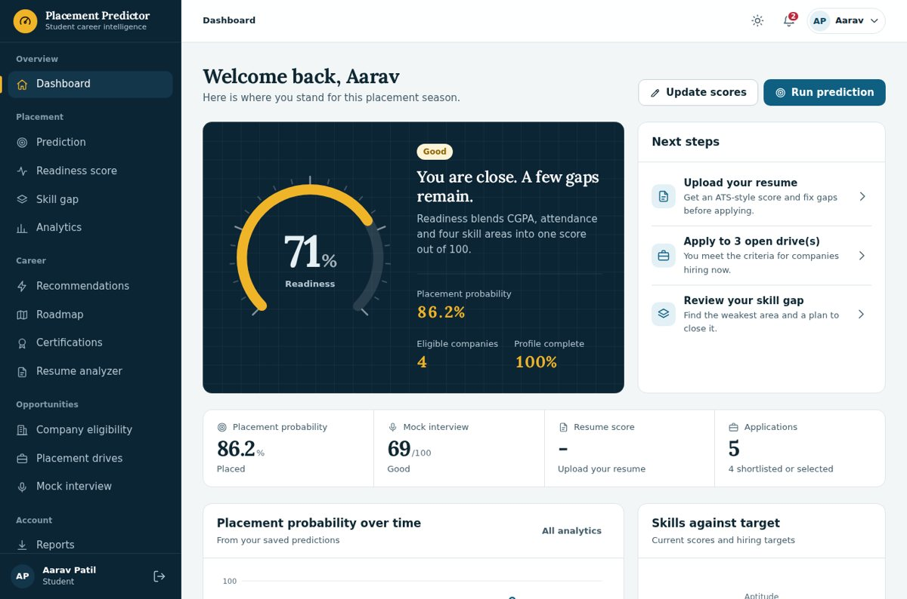
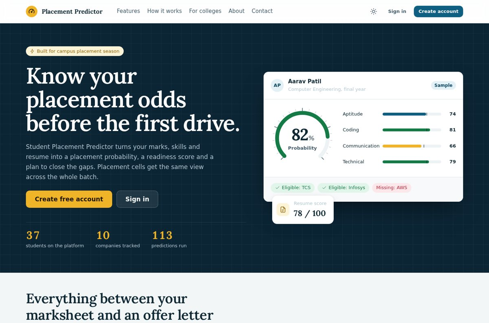
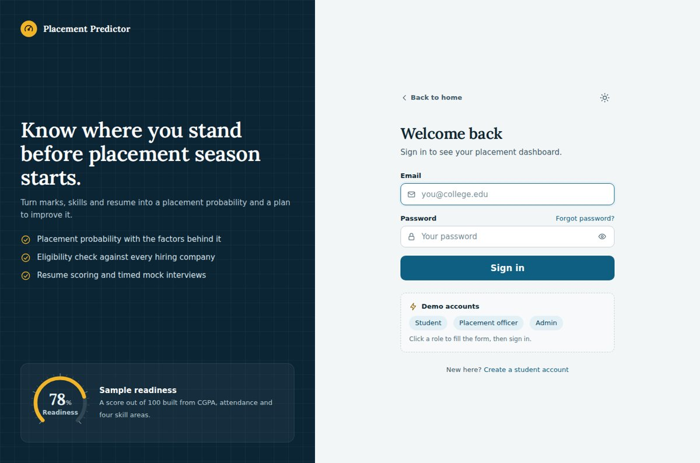
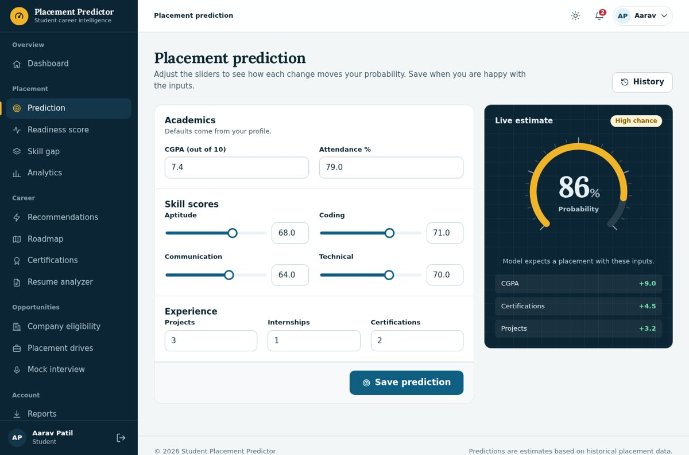
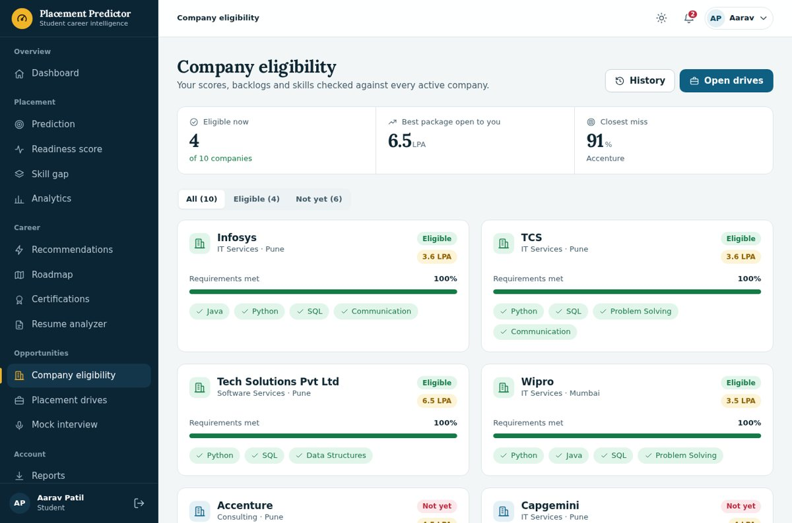
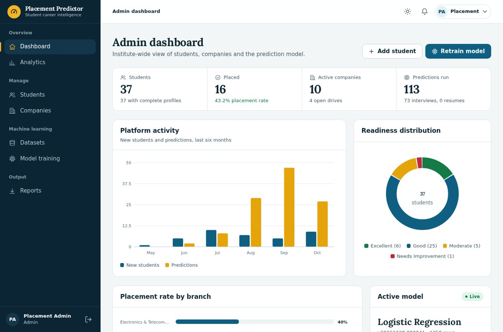
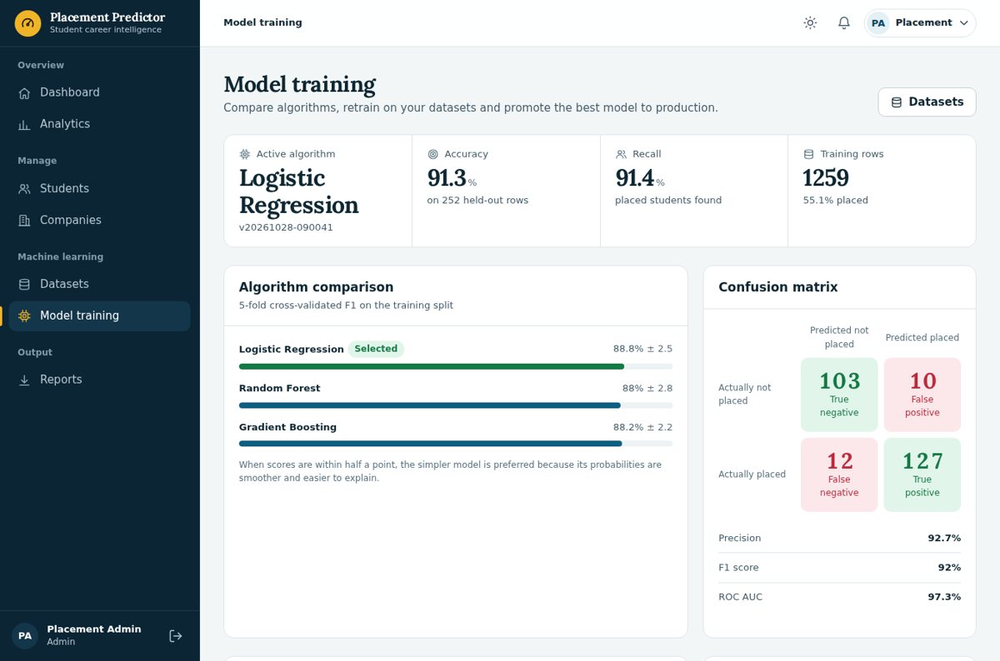
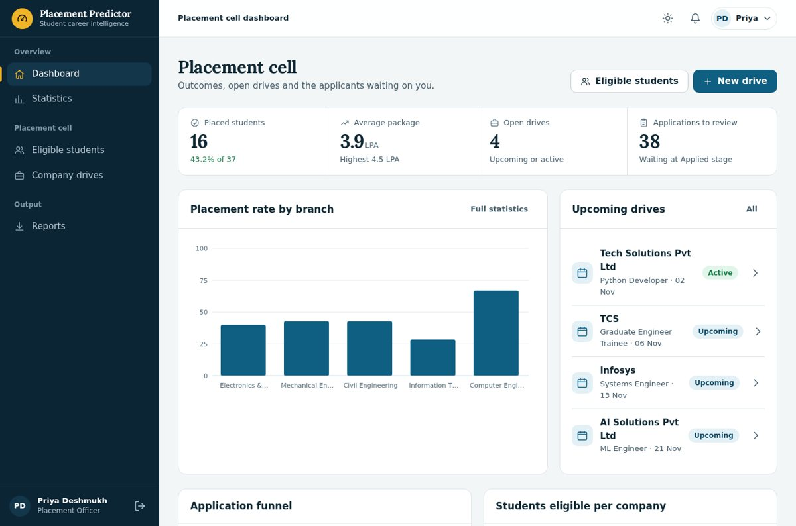
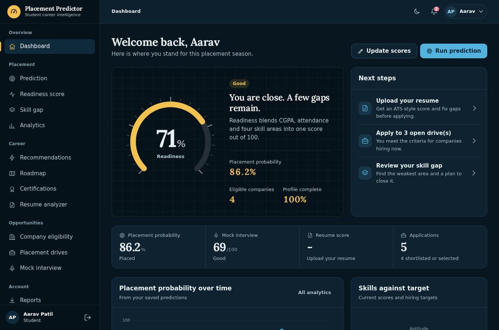

# Student Placement Predictor

A complete campus-placement platform. Students get a **placement probability**, **readiness score**, **skill-gap plan**, **company eligibility**, **resume score** and **mock interviews**. Placement officers run **drives and applicant pipelines**. Administrators manage **students, companies, datasets and the machine-learning model**.



## Quick start

Requires Python 3.10 or newer. No database server is needed to try it.

```bash
python -m venv venv
source venv/bin/activate          # Windows: venv\Scripts\activate
pip install -r requirements.txt
python run.py                     # http://127.0.0.1:5000
```

On first run the app creates a SQLite database, loads demo data and prints the demo sign-ins. Open the login page and click a role chip to fill the form.


| Role | Email | Password |
|---|---|---|
| Student | `sdhangar811@gmail.com` | Not displayed |
| Placement Officer | `ganeshmarathe8232@gmail.com` | Not displayed |
| Admin | `adityathube96k@gmail.com` | Not displayed |


> These accounts exist only when demo data is enabled (the default outside production). Never run production with them.

## Features

**Student**
- Dashboard with readiness dial, next steps, trend and skill radar
- Placement prediction with a **live what-if estimate** and per-factor explanation
- Readiness score, skill-gap analysis, course and certification recommendations, six-month roadmap
- Resume analyzer (section checks, detected skills, fixes); one click adds detected skills to the profile
- Company eligibility against every active company, with exactly what is missing
- Placement drives: apply to open drives and track each stage
- Timed mock interviews (Technical, Programming, Aptitude, HR, Behavioral) with review of every answer
- Personal analytics, PDF placement report, Excel history export, notifications

**Placement officer (TPO)**
- Outcome dashboard and branch-wise statistics
- Eligible and near-eligible students for any company
- Create drives (eligible students are notified automatically) and move applicants through *Applied, Shortlisted, Selected, Rejected*; selection records the placement
- Excel and CSV exports

**Administrator**
- Student management (add, edit, deactivate, delete) with search, filter, sort and pagination
- Company and eligibility-criteria management
- Dataset upload with validation, and **model retraining** that compares three algorithms, shows hold-out metrics, confusion matrix and feature importance, and keeps a version history
- Institute analytics and exports

## Switching to MySQL

Set these in `.env` (copy `.env.example`); tables are created for you:

```ini
DB_ENGINE=mysql
MYSQL_HOST=localhost
MYSQL_USER=root
MYSQL_PASSWORD=your_password
MYSQL_DATABASE=placement_predictor
```

Already have a database from an earlier version of this project? Run `python manage.py init-db`. It adds any missing columns and tables without touching your data. Back up first as usual.

Or run everything with Docker: `docker compose up --build` starts the app on port 5000 with MySQL

## Commands

```bash
python manage.py init-db          # create/upgrade tables
python manage.py create-user --role admin
python manage.py train            # retrain the model
python manage.py routes           # list every URL
python manage.py test             # 46 automated tests
```

## Project layout

```
app.py / run.py       application factory and entry point
routes/               feature blueprints            models/        data access
ml/                   training, registry, prediction analytics/    dashboard queries
database/             dual-engine layer, schema, seed
templates/ static/    server-rendered UI, design system, SVG charts (no CDN, no build step)
tests/                unit, page and workflow tests docs/         architecture, database, design system, routes
```

More detail: [Architecture](docs/ARCHITECTURE.md) · [Database](docs/DATABASE.md) · [Design system](docs/DESIGN_SYSTEM.md) · [Routes](docs/ROUTES.md)

## About the model and the data

The bundled `dataset/placement_dataset.csv` is **synthetic demo data** (about 1,200 rows, generated by `scripts/generate_dataset.py`; the original 93 sample rows are kept in `placement_dataset_original.csv`). Reported accuracy therefore describes the demo, not your campus. Upload your institute's real placement records in **Admin, Datasets**, then retrain.

Predictions are statistical estimates from past outcomes. They are meant to guide preparation, not to decide anyone's prospects.

## Production checklist

- `APP_ENV=production` and a long random `SECRET_KEY`
- `SESSION_COOKIE_SECURE=1` behind HTTPS
- `SEED_DEMO_DATA=0` (default in production); set `ADMIN_EMAIL` and `ADMIN_PASSWORD` to create the first admin
- Configure `MAIL_*` so password reset emails are delivered; without it, mail is written to `logs/outbox.log`
- Use MySQL, and persist `instance/` (resumes), `dataset/uploads/` and `ml/models/`
- Serve with `gunicorn --preload run:app` behind a reverse proxy

## Screenshots

| | |
|---|---|
|  |  |
|  |  |
|  |  |
|  |  |

## License

Add the licence of your choice. Lora font: SIL Open Font License 1.1 (see `static/fonts/README.txt`)
