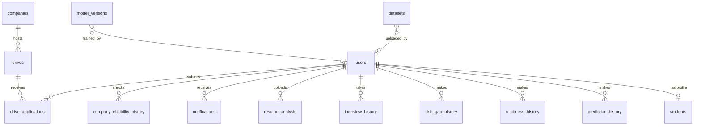

# Database design

One schema, two engines. `database/schema.py` is the single source of truth and renders DDL for **MySQL** (production) and **SQLite** (zero-config development). `python manage.py export-schema` writes the MySQL version to `database/schema.sql`.

Startup (`AUTO_INIT_DB=1`) runs `create_schema()`, which is safe to repeat: it creates missing tables, adds missing columns to tables created by older versions of the project, and creates indexes.

## Tables

| Table | Purpose |
|---|---|
| `users` | Accounts for all roles (`student`, `tpo`, `admin`); password hashes, active flag, last login |
| `students` | Profile: branch, year, CGPA, attendance, backlogs, four skill scores, projects/internships/certifications, skills, placement status, company and package |
| `prediction_history` | Every saved prediction with its inputs, probability and model version |
| `readiness_history`, `skill_gap_history` | Snapshots of the readiness score and skill-gap analysis |
| `interview_history` | Mock interview attempts; `details` holds each question, answer and evaluation as JSON |
| `resume_analysis` | Resume scores, detected skills, section checks and recommendations (the PDF itself lives outside `static/`) |
| `companies` | Hiring criteria used by the eligibility engine |
| `drives`, `drive_applications` | Recruitment drives and each student's application stage; marking an application *Selected* records the placement on the student |
| `company_eligibility_history` | Eligibility snapshots per student and company |
| `notifications` | In-app notifications (drive posted, status change, model retrained, contact message) |
| `datasets`, `model_versions` | Uploaded training data and the model registry |
| `contact_messages`, `report_log` | Contact form submissions and export audit trail |

## Writing portable SQL

Application code uses `%s` placeholders. The SQLite adapter translates them, so the same query runs on both engines. Keep to standard SQL: no engine-specific functions, aggregate dates in Python, and use `COALESCE` rather than `IFNULL`.
